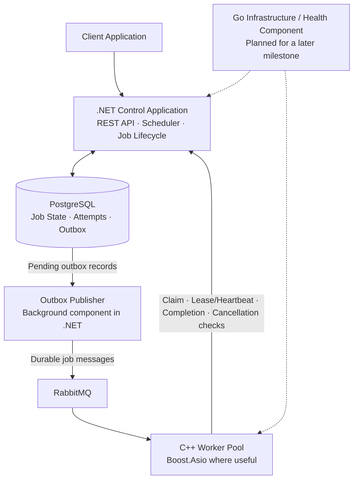

# Forge — Distributed Job Processing Platform

Forge is a multi-language systems engineering project exploring how to accept, schedule, execute, and recover background jobs across distributed workers.

The goal is to build a **portfolio-quality system incrementally**, with explicit design decisions, automated tests, reproducible benchmarks, and documented failure scenarios. The initial use case is log-file analysis; the platform is intended to support additional job types over time.

> **Project status:** Planning and architecture definition. The architecture below is a proposed baseline, not a claim that these capabilities have already been implemented.

## Why Forge?

Applications often need to perform work that is too slow, resource-intensive, or unreliable to run inside a request/response cycle. Examples include analysing large log files, generating reports, and processing datasets.

Forge aims to provide a shared service that lets an application submit a job and retrieve its status and result later, while the platform manages durable acceptance, scheduling, worker execution, retries, cancellation, and recovery.

## Initial Use Case: Log Analysis

The first job handler will analyse log files and produce a structured summary, such as:

- Total records processed.
- Counts by severity (`INFO`, `WARNING`, `ERROR`).
- Common error patterns.
- Time range and processing statistics.

Large input files will be referenced by location rather than embedded in broker messages. The initial storage mechanism for large input and output files remains a design decision to be validated before implementation.

## Proposed Architecture

This is an initial logical design. Component boundaries and communication contracts will be validated before they are treated as final.

### Planned technology responsibilities

| Technology | Intended responsibility |
|---|---|
| **C++** | Worker engine and job handlers; use Boost.Asio for networking/asynchronous I/O where it provides a clear benefit. |
| **C# / .NET** | REST API, job lifecycle rules, scheduling policy, cancellation requests, and outbox publishing. |
| **PostgreSQL** | Durable job state, execution attempts, and transactional outbox records. |
| **RabbitMQ** | Deliver work messages to workers and support acknowledgement/redelivery policies. |
| **Go** | A small infrastructure/health component in a later phase, after the core job path is stable. |
| **Docker** | Repeatable local development and integration-test environment. |

## Initial Design Principles

- **Durable acceptance:** a job is not reported as accepted until its durable record is committed according to the chosen storage guarantees.
- **Single source of truth:** PostgreSQL is the authoritative store for job lifecycle state; broker messages are delivery mechanisms, not proof of success.
- **At-least-once delivery:** duplicate delivery is expected and must be handled safely. Forge does not claim exactly-once execution or exactly-once external side effects.
- **Transactional outbox:** job creation and the corresponding outbox record are written in one database transaction; publishing is retried independently.
- **Safe completion:** results must not be accepted from a stale or no-longer-authorized execution attempt.
- **Recovery:** leases, heartbeats, retry limits, and explicit failure handling will be designed and tested.
- **Cooperative cancellation:** jobs may be cancelled while queued or running when their handler supports cancellation. A cancellation request does not magically undo external side effects already performed.
- **Fair scheduling:** priorities will be supported with an anti-starvation policy, such as aging. The policy and its guarantees will be measurable and documented.
- **Bounded resource use:** queue growth, worker concurrency, payload sizes, and retries must have explicit limits or policies.
- **Measure before optimizing:** throughput, latency, queue delay, resource usage, and recovery behaviour will be benchmarked rather than assumed.

## Intended Job Lifecycle

The initial state model is expected to include:

- `Queued`
- `Running`
- `CancelRequested`
- `Succeeded`
- `Failed`
- `Cancelled`

The exact allowed transitions and how retries relate to job state versus individual execution attempts will be documented and tested before implementation.

## Scope of the First Version

### Planned for V1

- Submit a job and receive a stable job identifier.
- Query job state and retrieve the result or error details.
- Support small inline payloads and references to large inputs.
- Execute jobs on multiple workers.
- Persist lifecycle state and execution-attempt history.
- Retry eligible failures with limits and backoff.
- Recover work after worker or service failures.
- Support priorities, anti-starvation scheduling, and cooperative cancellation.
- Provide logs, metrics, integration tests, and repeatable performance tests.

### Out of scope initially

- Multi-region active-active deployment.
- A complex dynamic plugin marketplace or execution of untrusted customer code.
- A blanket guarantee of exactly-once execution or exactly-once effects against arbitrary external systems.
- Advanced predictive auto-scaling.
- A sophisticated multi-tenant billing and quota platform.

## Performance Goals

The project will investigate workloads reaching **thousands of submitted jobs per second**. This is a benchmark target, not a measured result or production SLA.

Results will be reported with the workload definition and test environment. Admission throughput and completed-job throughput will be measured separately, along with:

- API latency (including P50, P95, and P99 where appropriate).
- Queue wait time and backlog growth.
- Completion throughput and failure rate.
- CPU, memory, network, and database resource usage.
- Recovery time after injected failures.

Performance numbers are meaningful only when job size, job duration, durability settings, hardware, and test conditions are stated.

## Incremental Development Roadmap

Each milestone will be small enough to build, test, review, and document independently. Planned work is not considered complete until code and tests demonstrate it.

1. **Design baseline** — define the job contract, state transitions, failure scenarios, and architecture decisions.
2. **Repository and development setup** — establish build/test conventions and a reproducible local environment.
3. **Minimal .NET API and durable state** — submit jobs and query their state using PostgreSQL.
4. **Transactional outbox and broker** — reliably publish job messages to RabbitMQ.
5. **First C++ worker** — execute the log-analysis handler and persist a result.
6. **Failure recovery** — add leases, heartbeats, retry rules, idempotent completion, and failure-injection tests.
7. **Cancellation and fair priorities** — implement and test the agreed policies.
8. **Observability and benchmarks** — add operational metrics and establish reproducible load tests.
9. **Go infrastructure component** — add only the infrastructure responsibility justified by the stable core system.
10. **Linux VPS deployment** — deploy after local integration and recovery tests are reliable.

## Development Philosophy

Forge will be developed incrementally. Each meaningful change should have a focused commit, relevant tests, and an update to the documentation when behaviour or design decisions change. Architecture choices will be recorded with their trade-offs, not treated as permanent simply because they were chosen first.

## Current Limitations

This repository begins with the project concept and proposed design. No throughput, reliability, recovery, or production-readiness claims should be inferred until those behaviours are implemented and verified by tests.

## License

Not selected yet.
